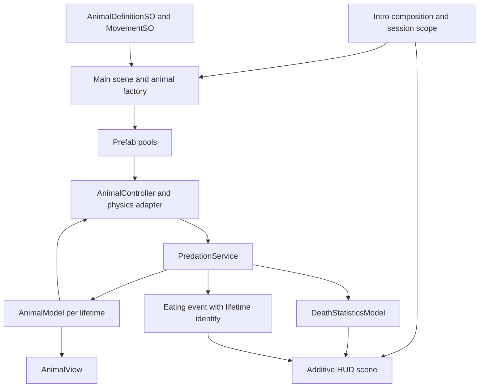

# Code Style and Architecture

This is the single authoritative project document for code style, architecture, engineering working rules. Codex and Cursor must read this entire document before generating, reviewing or modifying project-owned code, then inspect the relevant current implementation, callers and assembly references. Apply these requirements to generation, refactoring, code review and PR review. Read the repository `.editorconfig` for compatible tooling preferences.

Explicit user instructions take precedence. These requirements override less strict legacy examples and older source documents. Do not invent model APIs or treat target responsibilities as implemented classes. Keep this document current when an authorized change alters architecture, ownership or conventions; do not create parallel copies of the rules. Plans, iteration statuses and reports are not required generation context.

## Shared architecture requirements

These are mandatory user-established conventions, not claims that packages, scenes or gameplay systems already exist. Preserve them during bootstrap and documentation integration. Record existing implementation gaps separately; only explicit user instructions change a shared requirement. Documentation work alone does not perform migrations.

### MCV and Zenject

- Use Model / Controller / View responsibilities with models injected into both Views and Controllers through Zenject bindings. Zenject is the required DI framework when implementing the architecture. Do not use singleton access, service locators or runtime global searches for dependencies.
- Models own runtime state and invariants; Controllers coordinate input and operations; Views render current state, subscribe to typed events and publish intent. Keep domain code independent of Views, scene objects and DI container access.
- Constructor-inject plain C# types and use explicit injection methods for MonoBehaviours. Installers define project/session and scene-local lifetimes. Pair subscriptions with cleanup. Adding this documentation does not install Zenject or scaffold gameplay.

### Shared scene architecture requirements

- Require separate Intro (startup/bootstrap), Main (gameplay) and HUD (runtime UI) scenes, including in empty projects. Load HUD additively alongside Main when gameplay UI is needed.
- Document loading order, readiness, shared authoritative models, scene-local ownership and unload cleanup. Do not serialize cross-scene references or duplicate shared state, services or EventSystems.
- Missing or combined scenes are implementation gaps, not exceptions. Preserve this requirement in both skills and both templates.

### Authored configuration and asset ownership

- Use SO-suffixed ScriptableObject definitions and authored assets for configuration and all gameplay balance. Keep mutable session state and persistence separate; authored assets are read-only during play. Follow the typed SO folders described below.
- Use standard type-first roots: Assets/Scripts/<Logic>/, Assets/Prefabs/<Logic>/, Assets/SO/<Type>/, Assets/Models/<Logic>/, Assets/Materials/<Logic>/, Assets/Art/ and Assets/Audio/. Keep logical feature ownership explicit in grouping, namespaces, contracts and composition. Preserve an explicit destination-project layout decision; do not move existing assets during documentation integration.
- Keep separable responsibilities cohesive and shared architecture distinct from game-specific implementation. Preserve vendor-required folders, assembly boundaries, StreamingAssets semantics, GUIDs, serialized types and existing loading behavior during scoped changes.

### Resources folder and asset loading

- Do not place project-owned assets in any Unity `Resources` folder or introduce `Resources.Load` for project-owned content. Use serialized scene, prefab or ScriptableObject references, injected through Zenject where appropriate; use another explicit asset-loading system when the feature warrants it.
- The only permitted `Resources` exception is content required there by a third-party SDK. Keep that exception limited to the SDK's actual requirements; do not use its folder for unrelated project assets.
- Existing uses that do not meet this rule are implementation gaps, not precedents. Preserve their runtime behavior and GUIDs until a separately scoped migration replaces their loading paths and verifies dependencies.

### Recursive grouping by logic

- Group by subsystem or role only when the group has at least two related content files, excluding .meta files. Keep lone files at the nearest meaningful parent. Apply the rule recursively; avoid empty symmetry folders, redundant single-child chains and needless depth.
- Preserve SDK-required Resources and other necessary Unity-special folders and assembly/loading boundaries. Use AssetDatabase APIs for authorized moves and update affected tooling and documentation.

## ZooWorld system architecture

Status: iterations 1-3 implemented and tested; visible HUD pending. Owner: Andrii Maksymov.
Updated: 2026-11-02. Gameplay authority: [GDD](../GDD/GDD.md).
Execution order: [implementation plan](implementation-plan.md).

### Implemented state and gaps

The historical baseline `4b213e8` is the empty Unity 6000.3.26f1 URP project described in the
[bootstrap report](Reports/2026-11-02-bootstrap-validation.md). Iteration 1 adds these actual components:

- `ZooWorld.Domain` is an engine/DI-independent assembly for animal identity/state and session/statistics models.
- `ZooWorld.Runtime` references Domain and Zenject. `ZooWorld.Editor` owns setup tooling;
  separate EditMode and PlayMode test assemblies reference the runtime boundaries explicitly.
- Minimal Extenject Source is installed at pinned revision `8495d61cebe4175b358370a3599b32ae976d6de6`.
- Intro contains `SceneFlowController` and an explicit `SceneFlowSO` reference under `Assets/SO/Bootstrap/`.
  Main contains its camera/light/volume and `MainSceneController`; HUD contains `HudSceneRoot`.
- `SessionInstaller` binds one session, statistics model and identity sequence. `SceneScope`
  creates Main/HUD child containers; the shared session becomes Ready only after both roots validate injection.
- `AnimalLifetimeFactory` injects a fresh AnimalModel into AnimalController and an inactive AnimalView.
  AnimalView presents size/death state. `AnimalModel.Retire()` invalidates a released lifetime without
  recording a death; controllers and stale callbacks cannot act on that model again.
- `AnimalDefinitionSO` validates metadata/references/ranges; `MovementSO`/`IMovement` define the variation boundary.
  Frog/Snake assets and prefab variants, LinearMovement and JumpMovement are implemented.
- `MainSceneInstaller` binds SimulationSO, WorldBounds, WorldObstacles, AnimalPool and SimulationController in the Main scope.
  MainSceneController drives one Update/FixedUpdate loop after shared readiness. SimulationController
  owns the spawn schedule and stops/disposes its pool on session stop/failure.
- AnimalPool uses prefab-keyed inactive stacks and active lifetime leases. It expands lazily and retains
  the configured inactive capacity. RequestRelease disables contact participation and retires the model;
  storage/reuse occurs on a subsequent physics tick, after current contact callbacks have completed.
- Linear/jump motors preserve physical recoil and recover toward commanded motion. Grounded Rigidbody
  bodies use sphere colliders; the visual child follows a world-height jump arc. WorldBounds refreshes
  from the camera projection/transform and accounts for collision radius when returning animals.
- SessionInstaller now binds the domain-only PredationService beside shared death statistics.
  AnimalContactAdapter is inherited from the animal base prefab; it receives the current model/controller
  through lifetime injection and routes OnCollisionEnter through AnimalController.
- PredationService selects by role, then predator current size, then lower lifetime ID on exact ties.
  It rejects null/self/duplicate/dead/retired/recorded-identity pairs and undefined Omnivore contacts.
- Domain death and statistics mutation complete before observer callbacks. Publication order is
  AnimalModel.Died (immediate contact/visual suspension), statistics Changed, then EatingCommitted.
  The EatingEvent carries stable lifetime identities and model references; later UI consumers must
  verify that the eater's lifetime is still active before presenting delayed feedback.
- The factory injects the entire animal hierarchy. The contact adapter clears cached lifetime references
  on disable and rejects explicit requests carrying an old self-model. Pool release stays deferred.
- Main explicitly owns a WorldObstacles map with 16 static wall colliders from 14 prefab instances.
  WallCorner nests reusable WallSegment prefabs. SimulationController excludes walls from random
  spawn attempts and bounded fallback placement; physical contacts use the existing animal motor.
- Visible death-counter UI and eating labels remain pending iteration 4.

Normal shutdown, cancellation during load and unexpected HUD unload are covered by PlayMode tests.
An outstanding Unity scene load is allowed to finish and its scene is unloaded before cancellation completes.
Unexpected removal of a required scene stops the session; seamless HUD hot reload is not implemented.

Earlier source/test drafts are preserved locally in ignored `LocalDrafts/Gameplay/`, outside
Unity's imported Assets and outside Git. They are not the current implementation. Their
species definitions lack icons, Omnivore and size ranges; predation uses ID instead of size;
pooling is absent. Review and adapt them before any reuse. Do not copy them into Assets wholesale.

### Target responsibilities and dependency direction

The table describes the full target, including later-iteration responsibilities. The implementation
list above identifies what currently exists. Keep one authoritative owner per state and introduce
interfaces only at real variation or dependency boundaries.

| Component | Responsibility and lifetime |
| --- | --- |
| `AnimalDefinitionSO` | Read-only species ID, display name, Sprite icon, role, size range, movement and prefab references |
| `MovementSO` / `IMovement` | Authored strategy configuration; creates independent per-lifetime linear/jump state |
| `AnimalModel` | Plain C# lifetime ID, species identity, role, current size and one-shot alive/dead state |
| `AnimalController` | Injected per-lifetime model, movement and services; coordinates motion and contact requests |
| `AnimalView` | Renders the injected model; owns cached visual references and resets presentation on reuse |
| Physics adapter | Bridges Rigidbody timing/contact callbacks to the controller; physics types stay outside domain state |
| `PredationService` | Session service applying the agreed food-chain rules and committing a victim's death once |
| `DeathStatisticsModel` | Shared session death totals and typed change events; no UI or scene-object references |
| `AnimalFactory` / animal pools | Main-scene ownership of per-prefab views, lifetime creation, injection and reset/release |
| Spawn controller / world bounds | Main-scene spawn scheduling, random direction and camera-derived return behavior |
| HUD views / feedback presenter | HUD-scene rendering of shared statistics and pooled labels tied to a lifetime |
| Installers / scene coordinator | Intro-owned composition, explicit readiness, shared/session scopes and shutdown |

Unity adapters/controllers depend on domain models; domain models do not depend on Views,
Unity scene objects or Zenject. Constructor-inject plain classes; use explicit injection methods
for MonoBehaviours. Inject the same animal model into its Controller and View. Container access
is confined to composition/factory infrastructure. Species behavior is composed, rather than
implemented as one new controller subclass per species.



Arrows show composition/data flow, not permission for domain services to reference scene objects.

### Scene loading and lifetime ownership

1. Intro validates configuration, installs the session model/services and begins a cancellable load sequence.
2. Load Main and bind its explicit camera/world references and scene-local factory/pools.
3. Load HUD additively and inject its dependencies from the shared session scope.
4. Signal readiness after both roots validate injected models. The spawn schedule and gameplay
   ticks run only after this gate. Initial counter rendering is added in iteration 4.
5. On shutdown, stop spawn/tick producers, invalidate the session, cancel loads/feedback, disable
   contacts and release active animals, then dispose scene-local subscriptions/pools and unload scenes.

Intro retains the shared session scope while Main/HUD are loaded. There are no serialized
cross-scene references. Required-scene unload stops the current session; a new session creates
new totals. Exactly one EventSystem belongs to HUD if interaction
is implemented. OnDisable before injection performs no dependency-dependent work.

### Data, movement and contact flow

All balance remains in SO assets: species data under `Assets/SO/Animals/`, movement under
`Assets/SO/Movement/`, simulation settings under `Assets/SO/Simulation/`, presentation under
`Assets/SO/UI/`. These are target locations, not folders to create before content exists.
Use feature code under `Assets/Scripts/`, animal prefabs under `Assets/Prefabs/Animals/`, and
UI prefabs under `Assets/Prefabs/UI/`. Preserve the shared grouping/prefab/Resources rules above.

Uniformly sample initial size from the authored range, store it in AnimalModel and keep it fixed
throughout the lifetime, including after eating. Apply scale consistently to visuals and the grounded collision body.
The frog's visual child jumps; its physical body stays on the plane. Movement state is per lifetime,
not mutable state in shared MovementSO assets. Physics ticks and visible recoil remain meaningful.

The physics adapter submits a contact pair with current lifetime identities. PredationService
rejects self, dead, duplicate and stale-lifetime requests, applies the food-chain matrix, and commits
death before publishing statistics/presentation events. Predator/predator comparison uses current
size, replacing the old ID-only proposal. Predator/prey behavior remains as specified by the GDD.
Equal-size predator ties use the lower unique lifetime ID, as approved by the owner.
Omnivore interactions/counter mapping remain open in [Animals](../GDD/Animals.md);
AnimalDefinitionSO can author that role but rejects its entry into simulation.

The death event disables victim participation immediately. Release occurs after current contact
dispatch, so the same pooled view cannot reappear as a new animal inside old collision callbacks.
The UI observes committed outcomes and never increments authoritative totals itself.

### Pool lifecycle and callback safety

Animal pooling is required by the owner, independently of the general profiling guidance below.
Partition pools by prefab; prefab variants share a base composition but retain meaningful specialization.
Implemented policy: lazy expansion, configured inactive retention and destruction of inactive overflow;
there is no active population cap or prewarming. These values live in SimulationSO.

An inactive view is acquired, assigned a fresh lifetime ID/model/controller/movement state and size,
injected and positioned with contact disabled. Unity can preserve velocity on inactive bodies, so
activation is followed by a final velocity reset before enabling contacts. On release, disable contact/ticking, unsubscribe
and cancel owned work, clear references, reset Rigidbody velocities, scale and jump pose, and return
the view once. Scene unload may destroy the pool; teardown releases do not count as food-chain deaths.

Reuse the GameObject, not its domain identity. Track lifetime IDs in delayed callbacks and eating
labels, because a still-valid Transform may already represent another animal. New spawns cannot
inherit previous timers, collision commands, subscriptions or `Tasty!` labels. Validate this with
repeated pool-cycle and stale-callback tests before declaring pooling complete.

### Extensibility and verification boundaries

Adding a species with an existing role/movement requires new authored content rather than changes
to the central controller. A new locomotion behavior adds a MovementSO/IMovement implementation.
A new food-chain role requires an explicit matrix and statistics/presentation decision. Icon/name
metadata does not introduce an unrequested catalogue UI.

Domain tests cover contact invariants; PlayMode tests cover physics movement, recoil, grounded
colliders, pooled lifetime reset, stale callbacks and scene cleanup. Verify actual frame progression
and UI in the Editor. A catalogue of 1,000 species does not establish a performance requirement
or benchmark for 1,000 simultaneous bodies. The iteration plan records acceptance gates.

Change history: 2026-11-02 - captured the current bootstrap and agreed composition, size-based
predation, visual jump and pooling decisions. Iteration 1 subsequently implemented scene/session
composition and data validation; uniform size/no growth/lower-ID ties were approved by the owner.
Iteration 2 implemented prefab pools, spawning, independent movement motors and camera return;
36 EditMode/PlayMode cases passed. See the [iteration 2 report](Reports/2026-11-02-iteration-two-validation.md).
Iteration 3 implemented domain predation, an inherited physics adapter, atomic death/statistics
commit and typed meal events; 60 cases passed. See the [iteration 3 report](Reports/2026-11-02-iteration-three-validation.md).

## Code style

These requirements apply to new and meaningfully modified project-owned runtime code, Editor tools and tests. Preserve unrelated formatting and serialized references. Imported SDKs, packages and third-party assets are outside ordinary cleanup scope. Explicit readability requirements take precedence over compressed legacy examples.

## Language and readability

- All comments in project-owned code must be written in English, including inline comments, block comments and XML documentation comments. Write code descriptions, tooltips and engineering documentation in English as well. Comments explain a non-obvious reason, constraint or contract; do not narrate obvious code. Use English identifiers without transliteration. User-facing game text follows the project's localization/content requirements.
- Use four spaces, no tabs, block-scoped namespaces and Allman braces on separate lines. Remove trailing whitespace; use one blank line between methods. Prefer lines up to 120 characters without artificial breaks that hurt readability.
- Import namespaces with using directives at the beginning of the file and use short type names, including attributes and generic arguments. Prefer using UnityEngine.UI with Button over repeated UnityEngine.UI.Button qualifications.
- Resolve ambiguous type names with a clear file-local alias, for example using Random = UnityEngine.Random;. Retain a fully qualified name only when an import or alias cannot disambiguate it. Do not introduce global using directives.
- Remove unused and duplicate imports. Order System imports first, then other imports alphabetically; order aliases consistently by alias name. Preserve conditional compilation guards around platform-only imports.
- using UnityEditor is allowed only in an Editor assembly or within a UNITY_EDITOR guard together with its Editor-only consumers. An import never changes assembly dependency rules. SerializeField belongs to UnityEngine; SerializedObject and SerializedProperty belong to UnityEditor.
- Always use braces for if, else, for, foreach, while, do and using blocks, including one statement.
- One statement per line and one field/local declaration per declaration statement. Do not chain assignments. Never compress method bodies or control-flow blocks into one line. Behavior methods use block bodies; simple read-only expression-bodied properties are acceptable.
- Do not declare nested classes or structs, including record class and record struct. Declare each type, including enums, at namespace level in its own .cs file named after the type. This applies to runtime, helpers, Editor tools and tests.
- Prefer guard clauses with braces, named intermediate values and short focused methods. Avoid nested ternaries, nested/chained lambdas and long LINQ chains used to shorten gameplay/state transitions. Use a straightforward loop or named method when clearer. Do not introduce advanced syntax solely to save lines.
- Keep complex conditions in named methods/properties. Compare booleans directly. Use a switch for multi-state enum behavior when it improves clarity. Give meaningful repeated numbers/strings named constants or settings.

Incorrect:

```csharp
private void Apply(bool ready) { if (!ready) return; _view.Show(); _model.Begin(); }
```

Required:

```csharp
private void Apply(bool ready)
{
    if (!ready)
    {
        return;
    }

    _view.Show();
    _model.Begin();
}
```

## Names and state

- PascalCase types, methods, properties, events and constants; interface names start with I. Use camelCase parameters/locals and _camelCase private instance fields. Boolean names express intent, such as isReady, canRetry and hasReward. Avoid unclear abbreviations.
- Use explicit access modifiers; fields are private by default. Inspector fields use [SerializeField] private instead of public mutable fields. Use readonly for dependencies that do not change after construction.
- Expose state through read-only properties/methods. Do not expose mutable internal lists, arrays or save DTOs that allow callers to bypass model invariants. Do not add static mutable gameplay state.
- Use var when the type is clear from the right-hand side; use an explicit type when it clarifies a service/platform boundary or the expression obscures the type.
- New types belong to the appropriate project namespace. Do not rename/move existing serialized types or fields solely to improve style. A requested migration must inspect and preserve references; FormerlySerializedAs handles supported field renames, not every type/namespace move.
- Project-owned ScriptableObject class names end with SO, and their .cs filenames match: a clearly illustrative ExampleConfigSO in ExampleConfigSO.cs. This applies to the ScriptableObject definition, not every Editor tool that creates an asset or every plain data class. Use one SO suffix. Existing serialized types are migrated with reference preservation when that migration is authorized; do not rename vendor types.

## Responsibilities and dependencies

- Keep methods focused and classes responsible for one coherent concern. Separate domain decisions, presentation, persistence, platform SDK integration and analytics using existing project boundaries.
- Reuse existing contracts and dependency composition. Do not add an abstraction without a real alternative implementation or confirmed boundary. Avoid many boolean parameters; prefer explicit operations or a meaningful options type.
- Keep external platform SDK code behind adapters. Put platform compile symbols in adapters/composition roots, not across gameplay/UI classes. Use explicit unavailable results or a Null adapter where appropriate; external SDK failure must not block core gameplay.
- Keep state ownership, event flow and dependency lifetimes explicit. Inspect current code before claiming that a boundary is implemented.

## Unity lifecycle and references

- Use Awake for local initialization/cache, OnEnable/OnDisable for a symmetric subscription lifecycle and explicit initialization for dependencies whose readiness matters. Do not rely on accidental Start ordering or mix duplicate Start/OnEnable subscriptions.
- Protect OnEnable before injection. Constructor-inject plain C# types; use an explicit Construct method for MonoBehaviours. Pair Initialize/Dispose where that is the chosen owner lifecycle.
- Release resources and invalidate pending callbacks when the owner is disabled, despawned, unloaded or destroyed, as appropriate. Pooled objects reset listeners, tweens, coroutines, state and previous owner references before reuse.
- Validate required serialized references with actionable errors. Cache known components/cameras/IDs during preparation; do not perform runtime global searches for dependencies or repeated hierarchy scans in hot paths.
- Preserve .meta GUIDs, scene/prefab links and UnityEvent method references. Change serialized assets through Unity APIs; do not manually edit scene/prefab YAML while a live Editor is reachable.
- Use frame-independent motion when appropriate; physics-sensitive movement uses the relevant physics timing. Discrete state changes are event-driven. Do not add empty frame callbacks or polling for state that already has events.

## Async, events and errors

- Avoid async void except unavoidable event handlers. Async methods return Task or the project's existing async type; handle cancellation, object/session lifetime and exceptions. Do not introduce an async dependency solely for style.
- Call Unity APIs on the main thread. Block duplicate operations where required and release UI locks on success, failure and cancellation. Complete external SDK callbacks exactly once, including unavailable/error paths.
- Subscribe before triggering an operation that can finish synchronously. Keep attach/detach symmetric and do not use anonymous lambdas when later unsubscription requires the delegate.
- Reward callbacks return an explicit result; grant a reward only on confirmed completion. Use operation/session IDs to reject duplicate or stale callbacks.
- Validate external/config data, indices and collection boundaries. Check for an empty collection before accessing its final element; integer Random.Range excludes its upper bound. Use string.IsNullOrWhiteSpace where appropriate.
- Never use an empty catch, lose async exceptions or hide an economy/gameplay error behind a misleading zero/default value. Configuration has local defaults; remote config overrides them rather than becoming save data.
- Errors identify the subsystem, context and failed operation. Keep descriptions/log text in English. Do not log secrets, credentials, personal data or full private payloads; remove frame/animation debug spam.

## Performance and persistence

- Avoid allocations, LINQ materialization, string concatenation, reflection, component lookup and logging in hot paths. Reuse prepared collections/buffers and capacity; bound pools and define overflow behavior. Measure actual GC allocations and runtime cost instead of assuming every value type allocates.
- Use existing pools and reusable presentation when available. Do not add speculative optimization or prewarm every level. Cache ownership and cleanup must be explicit.
- Keep save data and configuration separate. Use compatible schema/migration and safe recovery from absent/corrupt data. Preserve receipt idempotence and the meaning of currency fields. Store platform persistence behind its existing adapter.
- UI publishes intent, models/services apply the operation, and views render state. Async UI operations handle cancellation and unavailable states without duplicate rewards or empty layout gaps.

## Applying the style

Before completing a code change, inspect every new or meaningfully modified method/type for required braces, one statement per line, readable block bodies and absence of nested classes/structs. Fix violations within the task's scope. Brevity belongs in reports, not compressed source code.

.editorconfig supplies preferences to compatible C# tooling; it does not itself install a formatter/analyzer or guarantee compliance. Use a compatible formatter when available and inspect its diff. Compilation and tests check behavior, not every style requirement. Do not claim a check ran when it did not.

## Architecture and dependencies

This is a convention baseline for a new project, not a catalogue of implemented systems. No gameplay modules or dependency injection framework are installed by these rules.

- Use the mandatory event-driven Model / Controller / View responsibilities defined above. Domain models are plain C# types; they own state and invariants without Unity scene, component or View references. Authored ScriptableObjects are configuration, not mutable domain state.
- Controllers coordinate input and operations; views render current state, subscribe to narrow typed events and publish intent. Render the initial state before relying on future events.
- Keep one authoritative owner for each state. Composition defines project, scene and session lifetimes; scene-local consumers must not duplicate shared models.
- Constructor-inject plain C# types and inject MonoBehaviour dependencies through Zenject. Preserve existing behavior while documenting legacy composition gaps; migrate only within authorized implementation scope.
- Domain contracts do not depend on feature presentation or platform adapters. Infrastructure composes dependencies. Inspect actual assembly definitions; avoid cycles and runtime references to Editor or test assemblies.
- Define cancellation and cleanup for scene transitions and session changes. Invalidate stale callbacks and release references to unloaded objects. Do not serialize references across scenes.

## Balance configuration with ScriptableObjects

- All authored gameplay balance settings must be stored in project-owned ScriptableObject assets. This includes unit stats, weapon damage/range/cadence/ammunition, faction modifiers, ability timings, capture rules, match tickets/duration, respawn delays, population/role limits, AI tuning and progression/economy values when those systems exist.
- Do not hard-code balance values in runtime scripts or duplicate them in MonoBehaviour Inspector fields, prefabs, scenes, static fields or separate configuration formats. MonoBehaviours and composition roots reference the appropriate SO assets; runtime consumers receive the required configuration or derived immutable values through explicit initialization.
- Keep one authoritative authored source for each balance value. Derive final values from baseline SO configuration and explicit modifier SO configuration; do not copy the same defaults into multiple assets or silently substitute hard-coded balance when a required asset/reference is missing. Validate missing configuration and invalid ranges with actionable errors before gameplay starts.
- SO classes and their .cs files end with `SO`, for example `UnitDefinitionSO.cs`, `WeaponDefinitionSO.cs` and `FactionDefinitionSO.cs`. Definitions belong under `Assets/Scripts/<Feature>/Content/` or a clearly named configuration subfolder of that feature; asset instances belong under `Assets/SO/<Type>/`.
- Typed subfolders under `Assets/SO/` are mandatory. Use `Assets/SO/Units/`, `Assets/SO/Weapons/`, `Assets/SO/Factions/`, and equivalent categories such as `Abilities/`, `Match/`, `Capture/`, `Respawn/` and `AI/` as needed. Do not place configuration assets directly in `Assets/SO/` or mix unrelated configuration types in one flat folder. Additional faction/content subfolders may be nested beneath the type folder when useful.
- Treat authored SO assets as read-only during play. Current HP, ammo, cooldowns, capture progress, ticket counts and other mutable session state belong to runtime models, not to the authored SO assets. Player preferences and save data remain separate from authored balance; engine-required rendering/input settings retain their supported locations.
- Create type folders and assets when implementing the corresponding content. Empty-project bootstrap installs these rules without inventing gameplay configuration, unused folders or placeholder systems. Existing serialized configuration is migrated only within authorized scope, through Unity APIs with GUID/reference preservation.

## Project structure and asset ownership

Create folders when content needs them; this table does not describe existing gameplay modules.

| Location | Purpose |
| --- | --- |
| `Assets/Scripts/<Feature>/` | Feature code grouped into Model, Controller, View or Content when appropriate |
| `Assets/Scripts/Infrastructure/` | Composition, persistence and platform adapters |
| `Assets/Scripts/Editor/` | Project-owned Editor tools |
| `Assets/Scripts/Tests/` | Relevant EditMode and PlayMode tests |
| `Assets/Prefabs/` | Feature prefabs and shared components |
| `Assets/SO/<Type>/` | Authored SO instances in mandatory type folders, e.g. Units, Weapons, Factions; definitions stay in Scripts |
| `Assets/Scenes/` | Mandatory Intro/Main/HUD scenes and additional independent flows |
| `Assets/Art/`, `Assets/Audio/` | Imported production content grouped by purpose |
| `Assets/Settings/` | Rendering, input and purpose-specific import settings |
| `Documentation/` | Maintained engineering and design documents |
| `AgentScripts/` | One-off tooling and verification outside runtime code |

- Group related assets by purpose; preserve vendor-supported locations. Keep intermediate exports and reports outside Assets.
- Move assets through AssetDatabase APIs, preserving GUIDs. Check string-based paths and assembly coverage separately.
- Use purpose-specific import settings for textures, models and audio. Choose platform overrides from actual targets; do not apply blanket reimports to vendor assets.
- Keep ScriptableObject fields private and serialized with a read-only consumption API. Validate required references, ranges and stable content IDs; do not mutate authored assets as session state.

## Prefab reuse and composition

- Repeated scene or runtime objects must use reusable prefab assets rather than independently assembled copies. This includes repeated units, platforms, weapons, projectiles, effects, props and UI components. Scene placement and runtime spawning use prefab instances and preserve their asset connection.
- Put shared hierarchy, components and references in a base prefab. Use Prefab Variants (derived/child prefabs) for meaningful specializations that share that base, such as different unit visuals or equipment assemblies. Keep overrides limited to the specialization; change shared behavior/composition in the base instead of repeating the same edit in every variant.
- Use nested prefabs for reusable child assemblies, such as a weapon mount, health bar or interaction prompt reused in several parent prefabs. A nested prefab is composition; a Prefab Variant inherits from a base. Choose the relationship that represents the content rather than duplicating whole hierarchies.
- Do not force unrelated objects into one base, create inheritance merely for folder organization, or build deep variant chains without a concrete shared responsibility. Prefer a small understandable hierarchy with clear ownership of each override.
- Store prefab assets in purpose/type subfolders under `Assets/Prefabs/`, such as `Units/`, `Vehicles/`, `Weapons/`, `World/`, `VFX/` and `UI/`, as content requires. Keep balance in SO assets referenced by the prefabs; prefab inheritance must not create duplicated balance settings.
- Avoid repeated scene-instance overrides or unpacking prefabs to make copies. Promote reusable changes into the appropriate base, variant or nested asset; retain instance overrides for actual placement-specific differences. Use Unity Prefab APIs, preserve GUIDs/references and verify that base changes propagate while intended variant overrides remain intact.
- Apply these rules when implementing repeated content. Empty-project bootstrap carries the conventions without generating placeholder prefab hierarchies. Existing assets are reorganized only within the authorized task scope.

## Visual asset consistency

Follow [Art Direction Guidelines](../GDD/ART_DIRECTION_GUIDELINES.md) for icon-family outlines, screen-size comparison and color-only reskins. Retain existing texture/sprite/atlas compression and import settings unless their change is explicitly requested.

## Presentation and runtime cost

- Update discrete state and UI on events. Continuous work runs only while required. Cache components, cameras and IDs during preparation; avoid global dependency searches and repeated hierarchy scans in gameplay.
- Pool frequently reused objects when measurements justify it. Define capacity, overflow, ownership and complete reset on reuse. Do not prewarm every level speculatively.
- Choose Canvas boundaries by update frequency, rendering and measured rebuild cost. Runtime UI must belong to the separate, additively loaded HUD scene required above; choose Canvas count and boundaries from measured needs.
- Keep input ownership and sorting explicit. Use one active EventSystem per ordinary UI context, disable raycasts on decorative graphics, and manage visibility, interaction and blocking together.
- Hidden UI stops unnecessary animation and subscriptions. Verify localized text length, safe areas and supported input when UI is implemented.

### Resource transfers between counters

- When resources or currency visibly fly between two counters, decrease the displayed source amount as each represented portion starts leaving it. Increase the displayed destination amount only as that portion starts arriving at the destination. The first departure starts the source countdown; the first arrival starts the destination count-up. Do not wait for the whole animation batch to finish or update both counters at transaction start.
- Apply the exact amount represented by each flying item or batch at its departure/arrival event. Amounts in flight belong to neither displayed endpoint. Split integer remainders exactly so the final displayed totals match the authoritative transfer; do not assume one visual item always represents one resource unit.
- Keep these presentation totals separate from authoritative model/save state and its transaction timing. Animation callbacks must not grant or spend the transfer again. Scope callbacks to their transfer so simultaneous or unrelated flights cannot affect the wrong counters; reconcile presentation to committed state when a flight is skipped, interrupted or its UI closes.
- When implementing this behavior, verify staggered departures and arrivals, exact final totals and interruption handling. This is a shared presentation requirement; carrying it into documentation does not implement or verify a transfer system.

## Serialization, persistence and Editor tools

- Preserve script GUIDs, serialized field values, content IDs and UnityEvent callbacks. Field renames, type moves and JSON changes require their appropriate migration mechanisms.
- Unity object lifetime needs Unity-aware checks; null-conditional operators do not detect destroyed Unity objects.
- Keep save DTOs separate from mutable runtime models and configuration. Validate load/migration, recovery and idempotent operations when persistence is introduced.
- Keep Editor preview separate from gameplay. Use SerializedObject/SerializedProperty, Undo and dirty handling. OnValidate performs only local lightweight validation.
- Asset removal requires dependency and runtime-loading evidence; absence of a text reference alone is insufficient. Resources and StreamingAssets have independent build inclusion rules.

## Working agreement and verification

- Communicate with Andrii in Russian. Keep code comments and new engineering/design documentation in English.
- Read git status, relevant implementation, callers, assembly definitions and nearby tests before changes. Preserve unrelated edits; keep work scoped to the request.
- Commit, push, create PRs or publish comments only when explicitly authorized. Do not reset, clean, force-push or amend without explicit authorization.
- Read ProjectSettings/ProjectVersion.txt and Packages/manifest.json when compatibility matters. Do not upgrade Unity or packages as a side effect.
- Prefer Unity CLI and follow its skill. Target the project explicitly; pass --caller plugin --skill <actual-skill> on every unity command invocation. Discover supported commands before using them.
- Use Unity APIs for serialized assets. Diagnose Safe Mode and sandbox visibility before falling back to MCP or UI, and explain the fallback. A timeout does not prove cancellation; inspect state before retrying.
- Verify compilation and relevant existing tests for code changes. Check Play Mode and visual captures when changed behavior needs them. Documentation edits do not require a build or Play Mode.
- Create player/platform builds only when the user explicitly requests a build. Implementing a feature, an MVP, a fix, or asking for verification does not authorize a build. Do not build automatically for smoke tests, screenshots, performance checks, delivery-gate checks or release-candidate validation. Use compilation, EditMode/PlayMode tests, the running Editor and Editor captures for ordinary verification. Record any platform-specific checks that remain unverified until an explicitly requested build is available. Apply the same rule to local, development, release and CI-triggered builds; preserve the requested target/scope when a build is authorized.
- Report actual checks and limitations. Keep large diagnostics in local reports. These rules do not imply that any gameplay system or test suite already exists.
