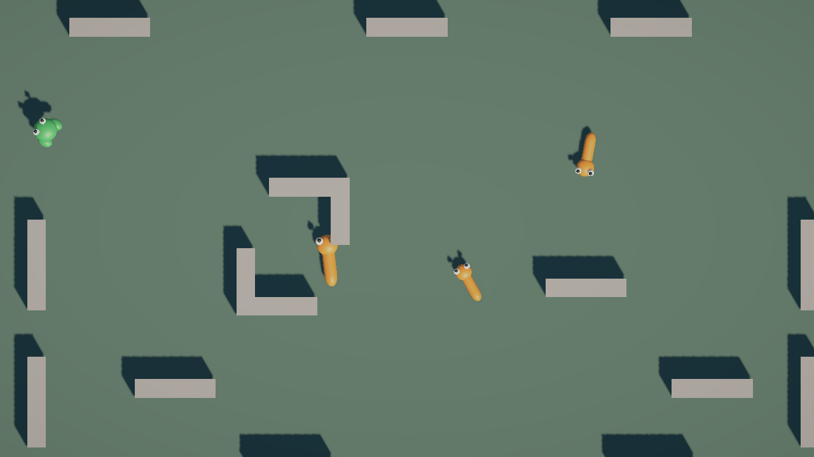

# Arena walls validation

Date: 2026-11-02. Unity 6000.3.26f1, Unity CLI 1.0.0-beta.15.
Scope: owner-requested walls matching the [supplied reference](../../GDD/References/arena-walls.png).

## Result

Main contains 14 connected prefab instances: 12 straight walls and two corners, totaling
16 static BoxColliders. WallCorner nests WallSegment instances. Both use one gray URP material
and the existing animal contact physics material. Open passages and partial edge segments
follow the reference; camera, animal art and ground material are unchanged.

MainSceneController explicitly references WorldObstacles; MainSceneInstaller injects it into
SimulationController. Spawn selection excludes wall volumes using the largest possible species
sphere. After random placement attempts, animal overlap may be accepted only outside walls.
A bounded grid fallback handles unlucky random wall hits. No pathfinding is added.

## Verification

- 39/39 EditMode and 24/24 PlayMode tests passed through Unity CLI.
- New PlayMode cases check 150 consecutive crowded spawns, actual snake/wall contact and
  frog/wall contact while the physical body remains grounded. Walls cause no food-chain deaths.
- Existing movement, pool reuse, food-chain, readiness and scene-lifetime tests still pass.
- Normal Intro startup loaded all three scenes; the player loop advanced from frame 869 to 2407.
- Captured and inspected the actual 1280x720 camera render below: gray segments, opposing
  central corners and shadows are visible, with animals moving in the open passages.
- Normal Play Mode console: zero errors and zero warnings; compilation completed successfully.
- No player/platform build was requested or produced.

Raw test envelopes are retained locally in ignored `LocalDrafts/Reports/arena-walls-*.json`.
