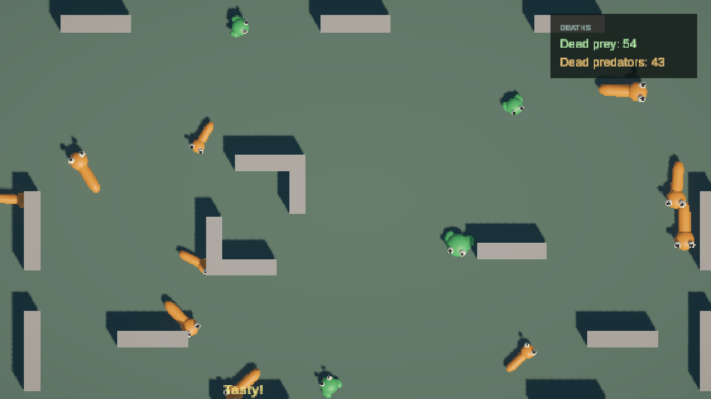

# Verification and handoff

Date: 2026-11-02. Unity 6000.3.26f1 (6.3 LTS), URP, Unity CLI 1.0.0-beta.15.
Scope: assignment requirements, agreed owner additions, extension proof and local handoff.
Checkout base: `b6d9e0d` (`HUD and feedback`). This step does not commit or publish changes.

## Requirement matrix

| Requirement | Implementation and evidence | Result |
| --- | --- | --- |
| Top-down 3D, primitive graphics | Main orthographic camera; Frog/Snake variants; inspected screen captures | Verified |
| One random animal every 1–2 seconds | SimulationSO validation and scheduler/cadence tests; observed 20 spawns over 29.868 game seconds | Verified |
| Random movement, physical collisions | Per-lifetime movement strategy and random turn schedule; movement, recoil and real collision tests | Verified |
| Redirect animals back into view | WorldBounds derives ground limits from camera; controller applies return direction; tests cover changing aspect ratios and radius | Verified |
| Frog jumps a fixed ground distance | JumpMovement tests measure ground distance and visual arc independently; contact body stays grounded | Verified |
| Snake moves linearly at fixed speed | LinearMovement tests measure displacement at different fixed-step settings | Verified |
| Prey contacts separate physically | Real Rigidbody collision/rebound tests; no food-chain deaths for prey pairs | Verified |
| Predators eat prey and other predators | Actual physics contact tests, domain matrix and larger/equal-size winner tests | Verified |
| Victim disappears; one death/event | Immediate visual/contact suspension, deferred recycling, repeated/stale callback tests | Verified |
| Tasty! beneath the eater on each meal | HUD tests cover both victim roles, tracking, stacking, expiry, disable, death and reused lifetime; inspected runtime capture | Verified |
| Top-right dead-prey/predator totals in uGUI | Separate TMP labels on overlay Canvas; initial/live totals, disable/re-enable and new-session tests | Verified |
| Clear extension to additional animal types | Temporary third species enters production scheduler, moves via existing controller/LinearMovement and reuses its prefab pool | Verified |
| DI/patterns; no ECS | Zenject session/scene/lifetime injection; domain/controller/view separation; Domain assembly has no engine references | Verified |
| Owner additions: species metadata, sizes and tie rule | Definition validation, uniform sampled size/no growth, larger predator and lower-ID tie tests | Verified |
| Owner additions: animal pool and reference walls | Reuse/reset and wall tests; 150 wall-free spawns; actual frog/snake wall contacts | Verified |
| Repository delivery | Existing public repository contains the project through checkout base; verification edits remain local in this step | Publication status explicit |

Omnivore is an owner-requested authoring value, not an assignment species. Its interactions
and counter category remain deliberately undefined and spawning is rejected until agreed.

## Automated checks

Final suite: **39 EditMode + 31 PlayMode = 70 passing cases**, zero failures/skips.
Final Console: zero errors/warnings; compilation completed. Editor restored to clean Intro
outside Play Mode. Documentation links, asset metadata and `git diff --check` pass.
The extension test is `PoolAndSpawnTests.NewSpeciesUsesExistingMovementAndPoolWithoutControllerChanges`.
It clones a definition only in memory, supplies a new ID/name/fixed size, selects it through the
real scheduler, validates injected model identity and movement, then returns/reacquires the same
view with a fresh lifetime. It destroys the temporary configuration; authored content remains
Frog and Snake. Core runtime code was not changed for the demonstration.

Existing checks include 12 repeated animal reuse cycles; real food-chain/wall physics;
movement at different physics steps; late/stale callback rejection; atomic death/statistics;
HUD pool/subscription cleanup; cancellation while loading; and unexpected required-scene unload.

## Normal runtime observation

Two snapshots from the same unpaused Intro/Main/HUD session:

| Metric | First snapshot | Second snapshot |
| --- | ---: | ---: |
| Frame | 17341 | 21706 |
| Game time (s) | 117.779 | 147.647 |
| Spawned animals | 80 | 100 |
| Active animals | 16 | 10 |
| Created animal views | 21 | 21 |
| Pool reuses | 59 | 79 |
| Dead prey | 33 | 50 |
| Dead predators | 31 | 40 |
| Presented meals | 64 | 90 |
| Created feedback labels | 3 | 3 |

Both snapshots contained live frogs and snakes. HUD strings matched both authoritative totals.
At the second snapshot, 100 spawns = 90 deaths + 10 active animals. The pool handled another
20 spawns without creating additional views, and three label objects had presented 90 meals.
This is a measured prototype run, not a GC, memory, frame-time or 1,000-animal benchmark.

The capture below preserves the normal simulation and naturally accumulated feedback/totals.
Its totals are later than the snapshot table. The [iteration 4 capture](2026-11-02-iteration-four-playmode.png)
provides a higher-resolution controlled view of the feedback typography.

## Handoff and limits

Open `Assets/Scenes/Intro.unity` in the stated Editor and press Play. See the
[README extension instructions](../../../README.md#extend-the-species-catalogue) for adding species.
Settings are under `Assets/SO/Animals`, `Movement`, `Simulation`, `UI` and `Bootstrap`.

No essential Frog/Snake assignment behavior is identified as missing in the verified Editor path.
Open scope: Omnivore decisions, device safe-area matrices, platform builds and platform performance.
There is no navigation/pathfinding or active-animal cap; crowded placement may accept animal
contacts while always excluding walls. No player input, persistence, economy, CrazyGames or CI
was requested. No player/platform build was created. Commit/push was not performed for this step.

Raw test envelopes, runtime snapshots and console diagnostics are retained locally in ignored
`LocalDrafts/Reports/handoff-*` files. The maintained report and capture are included in the
reviewable working tree. Earlier iteration reports remain historical records.
