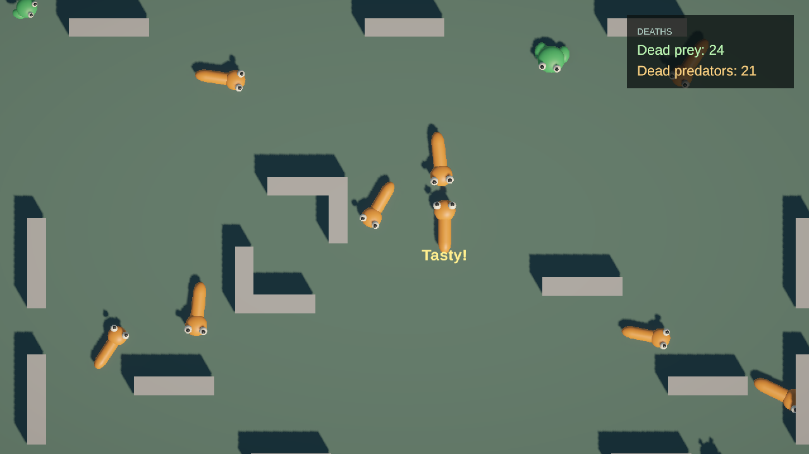

# Iteration 4 validation

Date: 2026-11-02. Environment: Unity 6000.3.26f1, URP, Unity CLI 1.0.0-beta.15.
Scope: additive uGUI death counters and pooled eating feedback.

## Implemented result

HUD has separate overlay canvases for event-driven counters and moving feedback.
DeathCounters and TastyLabel are reusable prefabs. HudPresentationSO stores text sizes,
feedback duration/offset/rise/stack spacing and inactive label retention.
Intro shares the explicitly owned Main camera and animal pool with the HUD scope through
Zenject; scene assets have no serialized cross-scene references. UI does not mutate death totals.

Every committed meal produces its own label for the current eater lifetime. Labels follow
its projected collision edge, stack for repeated meals, fade and return to the pool.
Eater death removes its labels immediately. Retired or recycled target views are rejected
before the next UI render. Disable clears labels/listeners; enable renders current totals.
Scene/session release disposes all feedback and subscriptions. No controls were introduced.

TMP Essential Resources were imported with the vendor's noninteractive importer, without
examples/extras. Its standard Resources assets are required vendor support, covered by the
project's third-party Resources exception. Project HUD content uses explicit asset references.

## Checks

- 39/39 EditMode and 30/30 PlayMode cases passed through Unity CLI.
- Six new HUD cases cover initial counters, both victim roles and duplicate contacts; following,
  expiry and label reuse; simultaneous meals and immediate cleanup on eater death; recycled
  animal lifetime isolation; disable/enable subscription symmetry; shutdown and new-session reset.
- All previous movement, pooling, walls, spawning, food-chain and scene-lifetime cases passed.
- Normal Intro startup was observed advancing from frame 3112 to 4723, with two HUD canvases.
  A screen-source capture showed naturally accumulated death totals and eating feedback.
- The final capture below uses the existing Full HD Game view, downsampled to 1280x720.
  A committed controller meal was triggered for a central snake and game time temporarily stopped
  to retain the one-second feedback for inspection. It is an actual rendered HUD, not a mockup.
- Normal Play Mode Console: zero errors, zero warnings; compilation completed successfully.
- No player/platform build was requested or created. Other device safe-area matrices and platform
  builds remain unverified. Final project handoff is iteration 5.

Raw test envelopes are retained locally in ignored `LocalDrafts/Reports/iteration-four-*.json`.

## Related documentation

- [Presentation specification](../../GDD/Presentation.md)
- [Current architecture](../CODE_STYLE_AND_ARCHITECTURE.md#zooworld-system-architecture)
- [Implementation plan](../implementation-plan.md)
