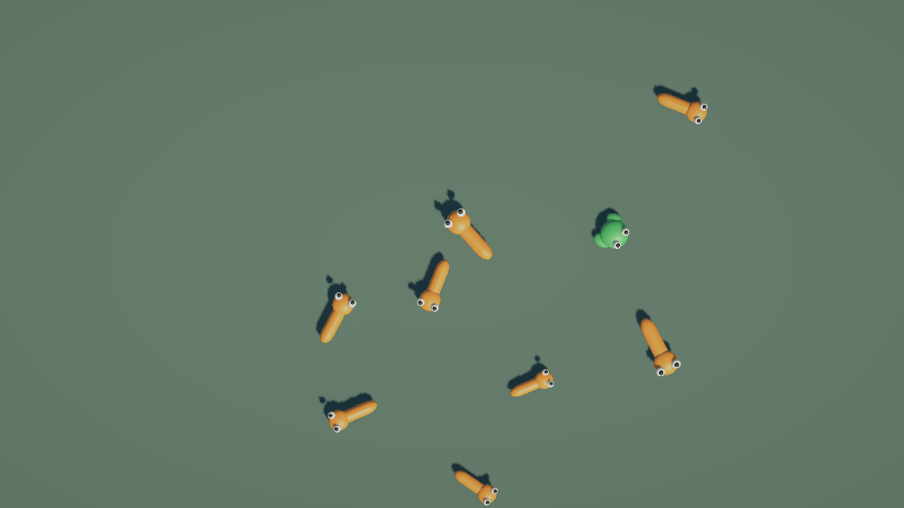

# Iteration 3 validation

Status: verified locally. Owner: Andrii Maksymov. Updated: 2026-11-02.
Scope: food-chain resolution from the [iteration plan](../implementation-plan.md).
Environment: Unity 6000.3.26f1 URP, live Editor driven through Unity CLI.

## Implemented

- Domain-only PredationService is bound once per session alongside DeathStatisticsModel.
- Prey/prey contacts do not cause deaths. Predator/prey contacts select the predator regardless
  of relative size. Predator/predator contacts select larger current size, then lower lifetime ID on exact ties.
- Null, self, duplicate-identity, dead, retired and previously recorded lifetime requests are rejected.
  Any Omnivore pair is rejected until its contact/counter rules are defined.
- Victim death and counter mutation commit before observer notifications. Publication order is
  Died, statistics Changed, then EatingCommitted with stable eater/victim lifetime identities.
- AnimalContactAdapter receives the current model/controller through hierarchy injection and routes
  OnCollisionEnter into the controller/service. It clears its references on disable and rejects stale self-model tokens.
- The adapter was installed on the common Animal prefab through PrefabUtility. Both Frog and
  Snake inherit exactly one adapter and remain prefab variants.
- Victim physics/visuals disable during death notification; pool storage/reuse waits for the next physics tick.

The resolver treats distinct contacts in Unity's callback order. It does not globally sort/arbitrate
a simultaneous contact graph. A dead actor cannot eat in a later callback; reversing the two
arguments of one valid pair cannot change its winner or produce a second death.

## Automated results

| Suite | Result | Coverage |
| --- | --- | --- |
| EditMode | 39 passed, 0 failed | Earlier data/session checks plus pair matrix, size/tie outcomes, reciprocal/repeated contacts, dead/retired identities, undefined Omnivore pairs, contact chains, observer re-entry and accounting before events |
| PlayMode | 21 passed, 0 failed | Earlier movement/pool/scene checks plus real predator/prey and predator/predator collisions, prey rebound, immediate victim suspension, deferred reuse, stale callbacks after reuse and teardown without deaths |

The real-body tests verify that a larger predator wins even when its ID is higher, and that
equal-size predators select the lower ID. The victim remains in active bookkeeping until the
subsequent pool tick, then its view is reusable with a new model. Requests carrying its old model
cannot kill or count the next occupant. Domain tests verify one meal event per committed death.

Full results are preserved locally in ignored `LocalDrafts/Reports/iteration-three-editmode.json`
and `iteration-three-playmode.json`.

## Normal simulation check

- Started from Intro with Main/HUD loaded and state Ready.
- Frame 9057: 34 spawned, 13 living, 12 dead prey, 9 dead predators, 17 pool reuses.
- Frame 16098: 67 spawned, 11 living, 28 dead prey, 28 dead predators, 49 pool reuses.
- Both snapshots satisfy `spawned = living + dead prey + dead predators`.
- Console reported no errors or warnings during the normal run.
- On graceful shutdown, the death total stayed at 71 while all remaining animals were released;
  teardown was not counted as predation. Intro was restored in Edit Mode after verification.

## Limits and next iteration

Visible death counters and `Tasty!` labels are not implemented. Iteration 4 will consume shared
statistics and typed meal events, validating that an eater's lifetime is still active before
showing delayed feedback. Omnivore behavior remains blocked. No growth after eating was added.
No player build, package upgrade, CI, commit or push was part of this iteration.
