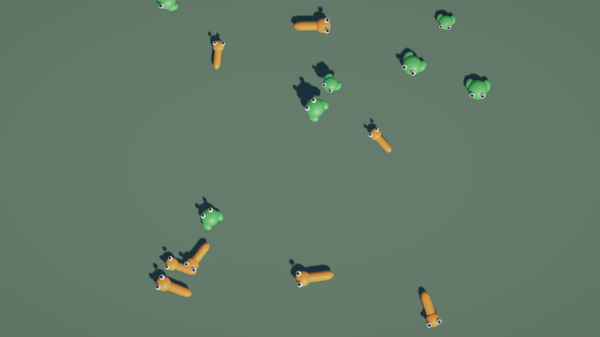

# Iteration 2 validation

Status: verified locally. Owner: Andrii Maksymov. Updated: 2026-11-02.
Scope: pool, spawn and movement from the [iteration plan](../implementation-plan.md).
Environment: Unity 6000.3.26f1 URP, connected Editor driven through Unity CLI.

## Implemented result

- Reusable inactive Animal base prefab with Frog/Snake prefab variants and primitive visuals.
  Both variants retain their base connection, verified through PrefabUtility.
- Frog/Snake definitions include icon, name, role, size range, movement and prefab references.
- Main uses a top-down orthographic camera, ground and explicit Animals root.
- MainSceneInstaller composes camera bounds, configuration, pool and simulation controller.
- One animal spawns after each 1-2 second interval once Main/HUD are ready. Initial population is zero.
- Independent linear/jump motors retain physics recoil; frog collision bodies stay on the ground plane.
- Prefab-keyed pools use fresh lifetime IDs and reset velocity, scale, visual pose and movement state.
  Retired models reject stale actions. Contacts disable immediately; storage waits for the next physics tick.
- Session stop/failure unsubscribes the simulation controller and disposes active/inactive pool objects.

All new Unity-serialized assets and scene changes were created through Editor APIs. The original
SampleScene and existing asset GUIDs were preserved. Unity reserialized the template Mobile RP
asset to its current URP schema; no Editor/package upgrade was performed.

## Automated verification

| Suite | Result | Meaningful checks |
| --- | --- | --- |
| EditMode regression | 20 passed, 0 failed | Configuration, identity, DI, session readiness and death-state invariants |
| PlayMode | 16 passed, 0 failed | Existing scene lifecycle, fixed-speed travel at two steps, fixed jump distance/arc, independent movement state, real collision rebound, invalid movement settings, pool reset, stale leases, separate prefab pools, cadence and three camera aspect ratios |

Pool tests reuse the same GameObject for 12 cycles while assigning new lifetime IDs and sizes.
They alter velocity and visual pose before release, then verify reset state and reject the old
lease/controller without affecting the next occupant. Stopping a session clears active leases.

The first PlayMode run found retained velocity on reactivated Rigidbody objects. The reset was
moved after GameObject activation, while collision participation remains disabled. The full
16-case PlayMode set passed after that fix. Movement/pool code was not declared complete on the failed run.

Full results are preserved in ignored local `LocalDrafts/Reports/iteration-two-editmode.json`
and `iteration-two-playmode.json`. These are local diagnostics, not required repository content.

## Normal startup and visual check

- Started from Intro with Main/HUD loaded and shared state Ready.
- Observed 9 spawned animals: 5 frogs and 4 snakes at the first diagnostic snapshot.
- Verified frame progression from 3184 to 6069 and movement of lifetime 1 from
  `(2.39, 0.00, 8.43)` to `(5.21, 0.00, 2.12)`; 19 animals had spawned at the second snapshot.
- Inspected the camera capture below: both primitive species, varied sizes, ground and shadows are visible.
- Console showed no errors or warnings during the normal capture check.
- Stopped the session gracefully, exited Play Mode and restored Intro as the Editor startup scene.

## Current authored tuning

| Setting | Value |
| --- | --- |
| Spawn interval | 1-2 s, uniform species selection |
| Direction-change interval | 1.5-3.5 s |
| Frog jump | 1.2 s start interval, 0.45 s duration, 1.8 units ground distance, 0.7 units visual height |
| Snake speed | 2 units/s |
| Collision-recoil recovery | 4 units/s squared |
| Size multiplier | Frog 0.8-1.2; Snake 0.9-1.3 |
| Inactive retention | 16 per prefab, lazy allocation, no prewarming |
| Placement | Eight clearance attempts, 0.5 units viewport padding, 0.15 units separation |

These are editable prototype tuning values. Spawn emits at most one animal per Update and
does not catch up with a batch after a stall. Placement falls back to physics separation after
its configured attempts, preserving cadence. There is no active population cap.

## Remaining scope

Food-chain resolution, automatic death statistics and `Tasty!` feedback are not implemented;
normal simulation contacts currently only separate by physics. Omnivore behavior remains blocked
pending its rules. The pool can recycle committed dead models, but the resolver arrives in iteration 3.
No 1,000-body performance claim, player build, CI, commit or push is part of this verification.
